# ☕ Coffee Shop — online ordering for a café (Django)

A complete café website: customers browse the menu, order online and **follow their order live**;
the owner runs everything from a **separate dashboard** — live orders, products, opening switch.

**🔗 Live demo: <https://coffee-demo.duckdns.org>** &nbsp;·&nbsp; Django 5.2 · 200+ tests · deployed with Caddy + gunicorn

<p align="center">
  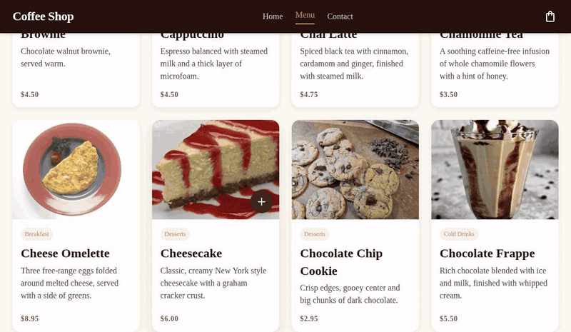
</p>

---

## ✨ What it does

### For customers
- **Menu** with category filters, product detail pages and a fully responsive layout.
- **Cart drawer** — quick-add from the menu, quantity steppers, an animation that follows the product all the way to the cart.
- **Checkout** for pickup or dine-in, with an email confirmation when an address is given.
- **Live order tracking** at an unguessable link (`/track/<uuid>/`): *Pending → Preparing → Ready → Completed*, updating on its own.
- **Contact form** with validation and field-level errors.
- Friendly **"we're closed"** banner and a disabled checkout when the shop is not accepting orders.

### For the owner (`/dashboard/`, staff only)
- **Live orders board** by status, with one-click actions and a sound + tab counter when a new order arrives.
- **Product management** — add, edit, hide, feature and delete products; **photo upload with automatic resizing**
  (EXIF orientation fixed, 1200 px JPEG) — no need to touch the Django admin.
- **Open / pause orders** switch, optional opening hours and an alert email for new orders (in **Settings**).
- A standalone space: no customer navigation, `noindex`, its own header.

### Under the hood
- Cart in the session — prices always come from the database, never from the browser.
- Order lines keep a **snapshot** of name and price: changing or deleting a product never rewrites history.
- **Rate limiting** on checkout and contact (per client IP), 5 MB / real-image validation on uploads,
  CSRF everywhere, staff-only views, safe redirects.
- Production-ready: HTTPS redirect, secure cookies, HSTS, WhiteNoise, `check --deploy` clean —
  see [Deployment](#-deployment).
- `seed_demo` command with 40 products (8 per category) and photos, plus a daily refresh of the demo orders.

## 📸 Screenshots

| Menu | Product detail |
|:--:|:--:|
| 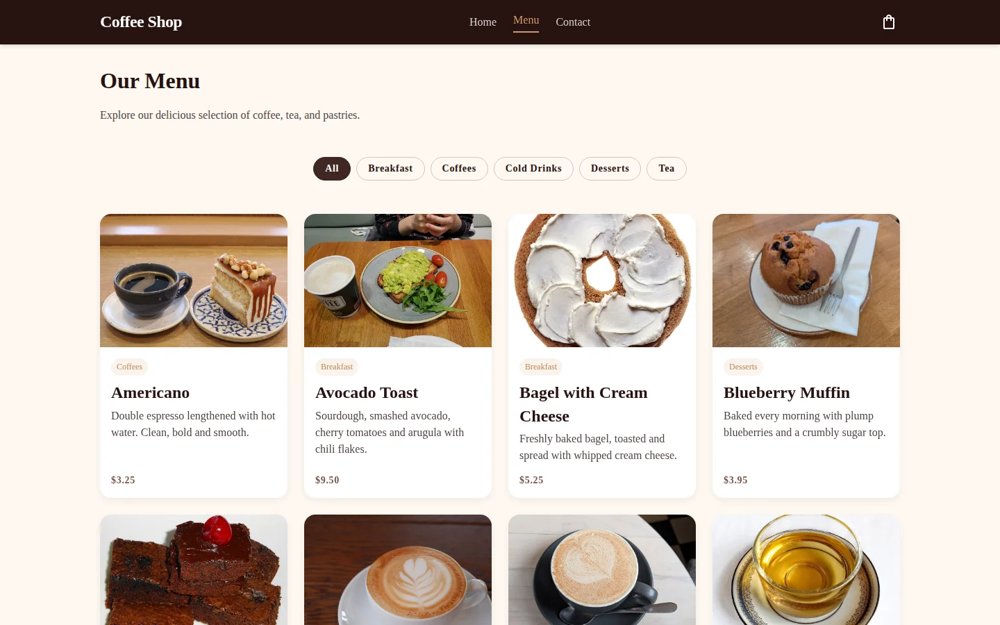 | 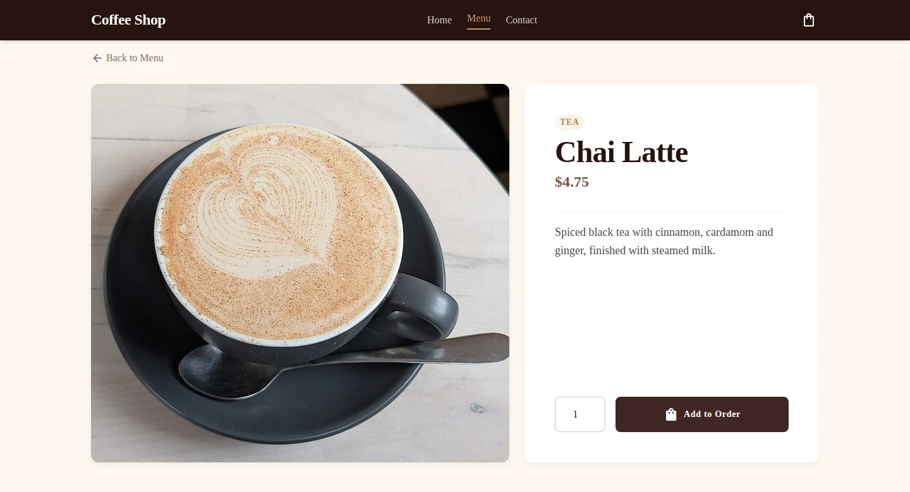 |
| **Cart drawer** | **Checkout** |
| 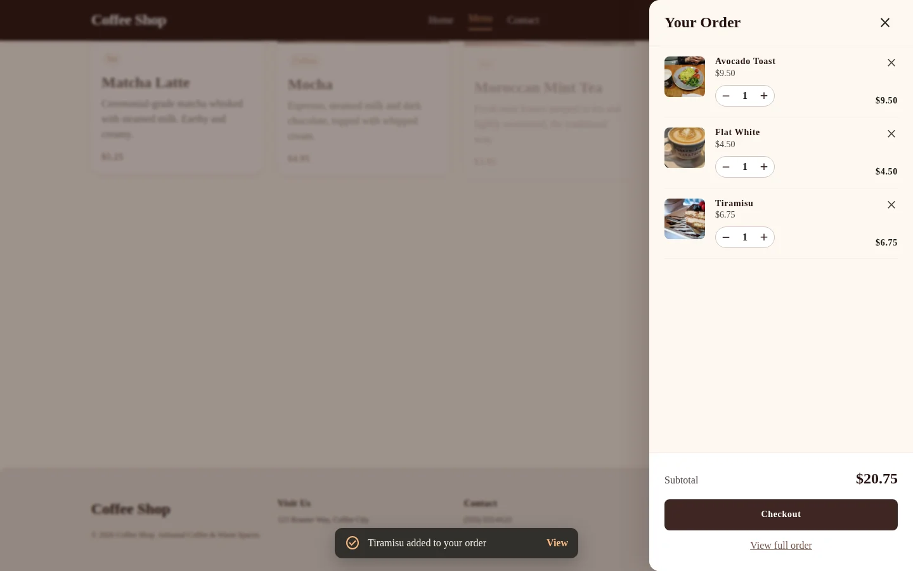 | 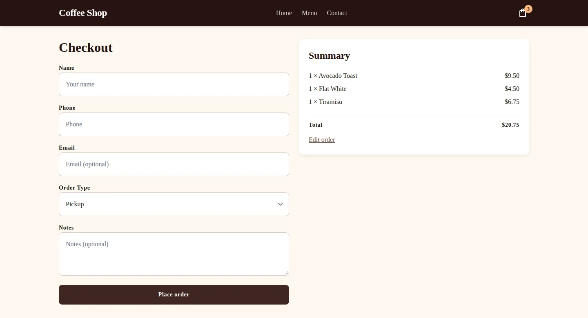 |

**Live order tracking** (customer)

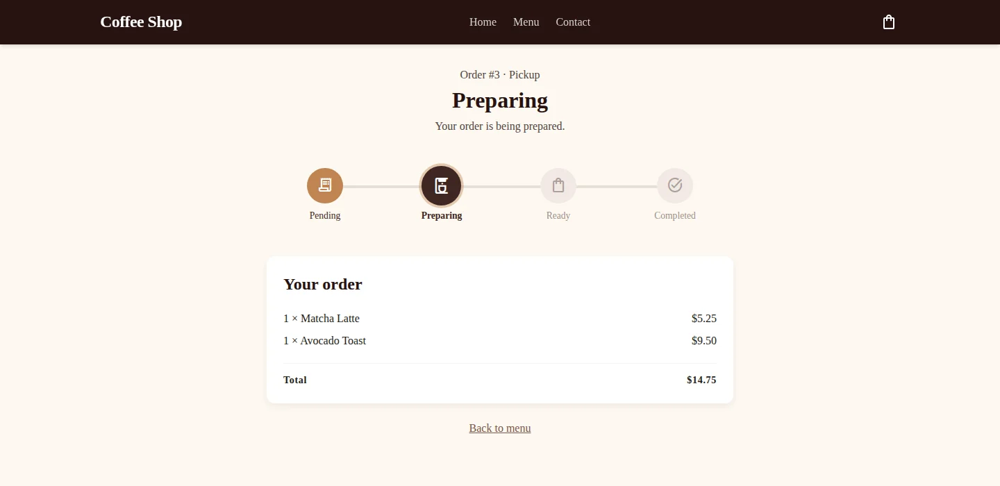

**Mobile**

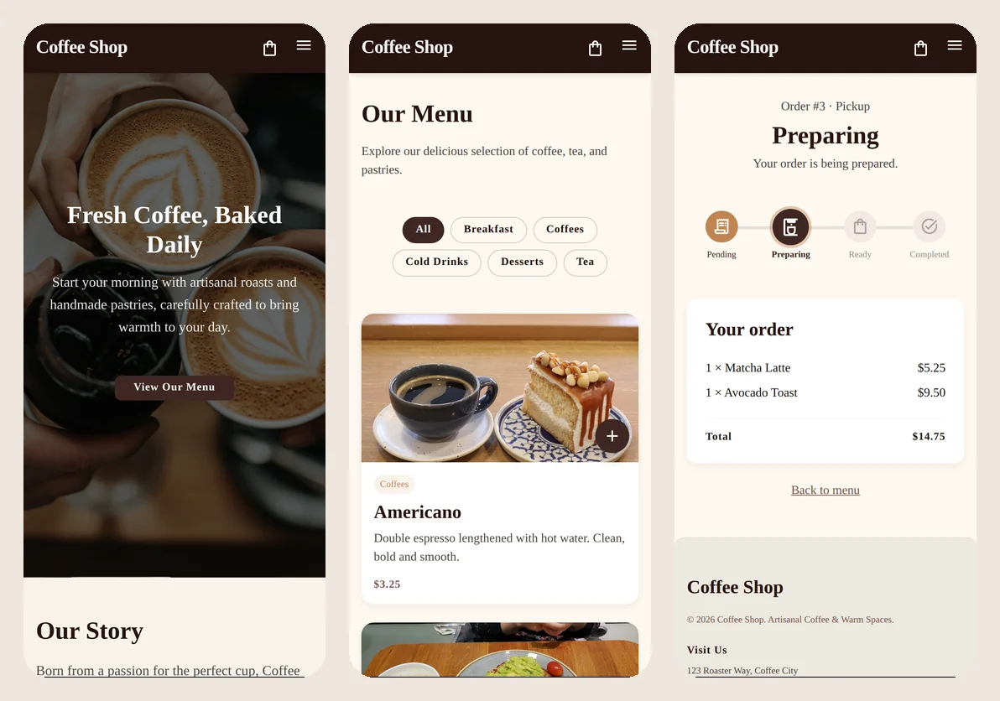

**Owner dashboard** — orders board

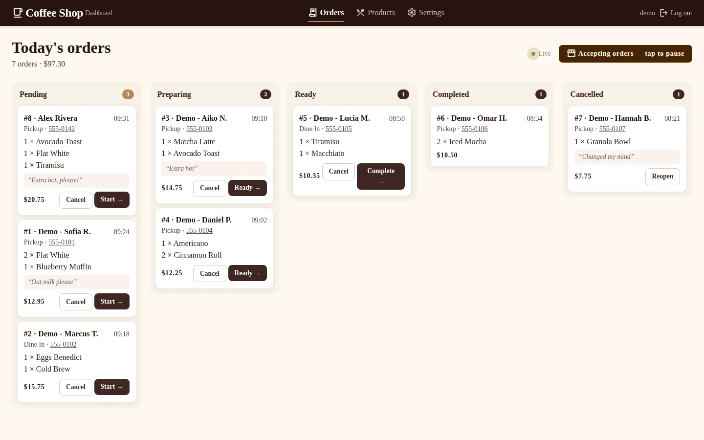

| Products | Edit a product |
|:--:|:--:|
| 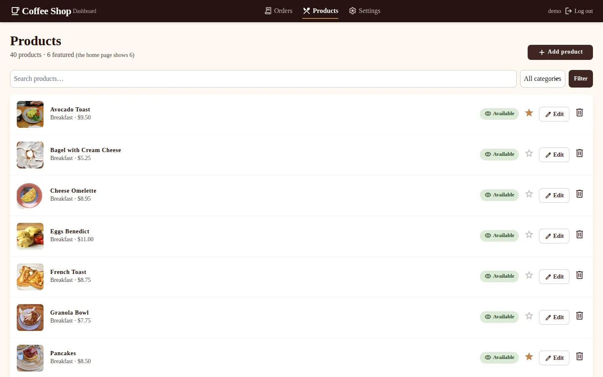 | 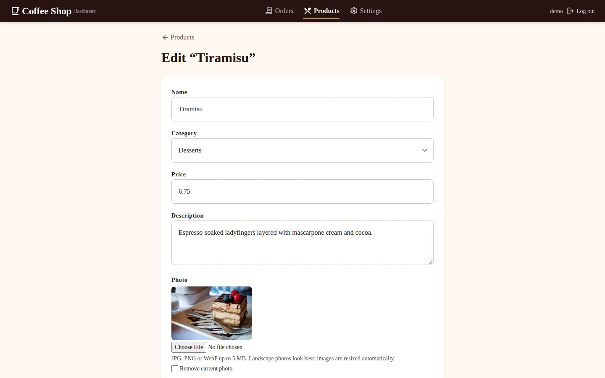 |

<details>
<summary>Home page</summary>

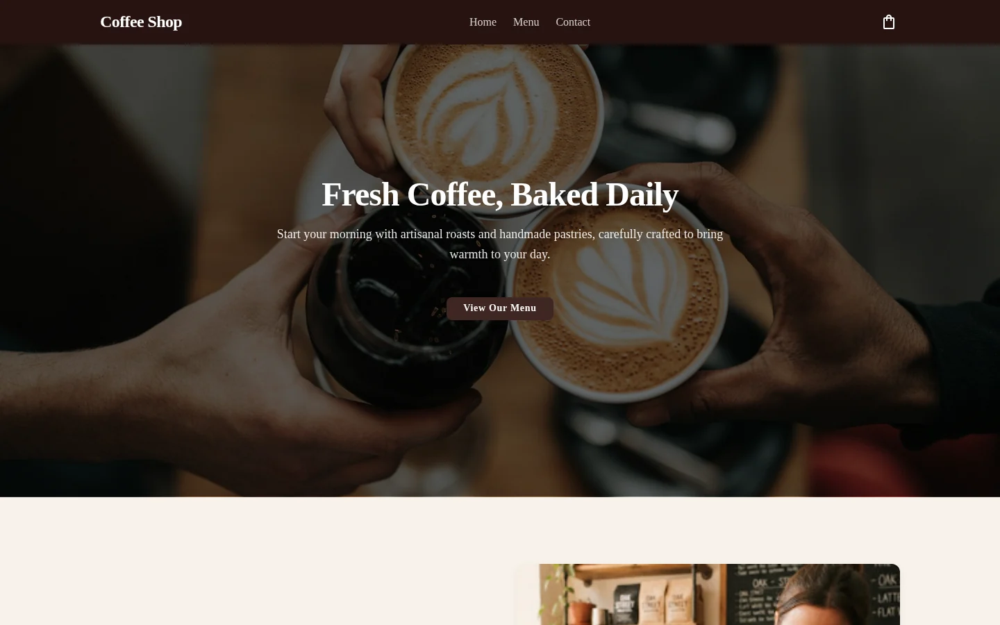
</details>

## 🛠 Tech stack

| Layer | Technology |
|---|---|
| Backend | Python, **Django 5.2** (tested on Python 3.14) |
| Database | SQLite (Django ORM throughout) |
| Frontend | Server-rendered templates, Tailwind CSS (CDN), Material Symbols, vanilla JS |
| Images | Pillow (validation, resize, JPEG optimisation) |
| Production | gunicorn, WhiteNoise, Caddy (automatic HTTPS), systemd |
| Tests | Django `TestCase` — 200+ tests |

## 🚀 Run it locally

```bash
git clone https://github.com/joeescarcega8879/Coffe-Shop.git
cd Coffe-Shop

python -m venv venv && source venv/bin/activate      # Windows: venv\Scripts\activate
pip install -r requirements.txt

python manage.py migrate
python manage.py seed_demo --with-orders              # 40 products with photos + sample orders
python manage.py createsuperuser                      # your owner login
python manage.py runserver
```

Open **<http://127.0.0.1:8000/>**. No environment variables are needed for development.

| Page | URL |
|---|---|
| Home / Menu / Contact | `/`, `/menu/`, `/contact/` |
| Cart / Checkout | `/cart/`, `/checkout/` |
| Order tracking | `/track/<uuid>/` (link shown after ordering) |
| **Owner dashboard** | `/dashboard/` (staff login) |
| Products (owner) | `/dashboard/products/` |
| Django admin | `/admin/` |

> Emails are printed in the console during development. To try the full flow: place an order,
> open the tracking link, then advance the order from `/dashboard/` in another tab.

Useful commands:

```bash
python manage.py seed_demo                  # add the demo products that are missing (idempotent)
python manage.py seed_demo --force          # reset the demo products' price / description / photo
python manage.py seed_demo --refresh-orders # recreate the sample orders dated today
```

## 🧪 Tests

```bash
python manage.py test
```

Covers models, views, the cart and checkout, order tracking, the dashboard (including that customers
and anonymous users cannot reach it), product management and image handling, emails, store hours,
rate limiting, the seed command and the production configuration (`check --deploy`, deploy files).
Tests use a temporary database and a temporary media folder — your data is untouched.

## 🗂 Project structure

```
Coffe-Shop/
├── core/                  # settings (env-driven), urls, ratelimit.py
├── menu/                  # categories, products, contact
│   ├── dashboard.py       #   owner product management
│   ├── images.py          #   photo validation / resizing
│   ├── management/commands/seed_demo.py
│   └── fixtures/demo_images/   # demo photos + ATTRIBUTIONS.md
├── orders/                # cart, checkout, orders, tracking, owner orders board
│   ├── cart.py            #   session cart
│   ├── emails.py          #   confirmation + new-order alert
│   └── models.py          #   Order, OrderItem, StoreSettings
├── templates/             # base (shop), dashboard/ (owner layout), menu/, orders/
├── static/                # css, js (cart, tracking, dashboard)
├── deploy/                # Caddyfile, systemd units, deploy.sh, server guide
├── docs/screenshots/
└── .env.example           # every environment variable, documented
```

## 🌐 Deployment

Tested stack on a small Linux VPS: **Caddy** (automatic HTTPS) → **gunicorn** → Django, managed by systemd.

- Step-by-step server guide: **[deploy/README.md](deploy/README.md)**
- All configuration comes from environment variables — see [`.env.example`](.env.example).
- With `DEBUG=False` the app enables HTTPS redirect, secure cookies and HSTS.
- Update a running server with `./deploy/deploy.sh` — it backs up the database, pulls, migrates,
  collects static files, restarts and health-checks.
- Optional daily timer that keeps the **demo** dashboard populated (`deploy/coffeeshop-demo-refresh.*`).

## 📷 Photo credits

The demo product photos come from Wikimedia Commons under CC0, public domain or CC BY licenses.
Authors and sources are listed in [`menu/fixtures/demo_images/ATTRIBUTIONS.md`](menu/fixtures/demo_images/ATTRIBUTIONS.md)
— keep that file with the photos if you publish them.

---

Made with ☕ — Coffee Shop project
